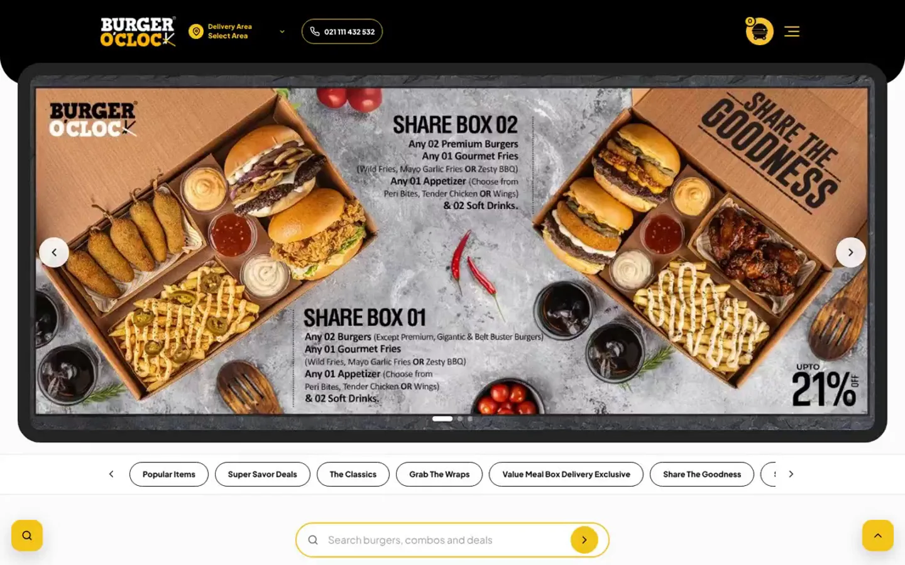
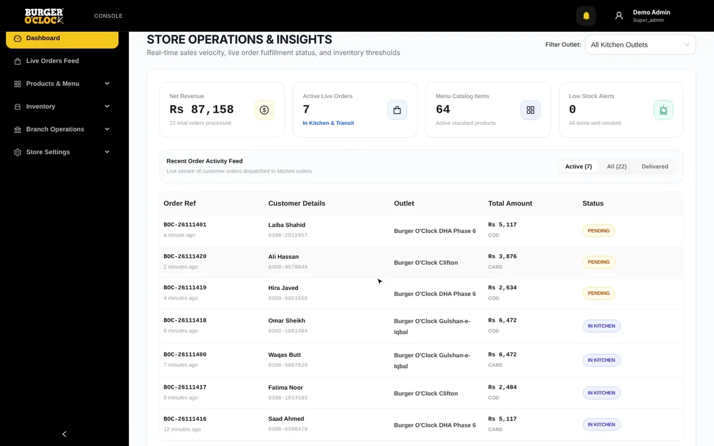

# Burger O'Clock

The ordering website and admin system for Burger O'Clock, a multi-branch burger chain. I built it end to end, front end, back end and admin panel, during my full-stack internship at CodeLabs (July to August 2026).

**Live:** [burger-o-clock-gamma.vercel.app](https://burger-o-clock-gamma.vercel.app)



## The storefront

- Menu, deals and homepage sections, all managed from the admin panel
- Cart, checkout with cash on delivery or card (Safepay), and live order tracking
- Each order goes to the nearest branch, with a delivery estimate based on that branch's live kitchen queue

## The admin panel



- **Orders:** a live queue for every branch, moved through the kitchen stage by stage
- **Menu:** products, categories, deals and the homepage sections
- **Inventory:** stock for each branch, suppliers, purchase orders and stock counts
- **Recipes:** what each item uses, so ingredients are deducted from stock automatically, earliest expiry first, and each item's cost and margin are visible
- **Branches and staff:** branch details, delivery areas, staff accounts, and roles built from individual permissions

## How it's built

| | |
| --- | --- |
| Front end | Next.js (App Router), React 19, Redux Toolkit with RTK Query, Ant Design, Tailwind CSS |
| Back end | Node.js, Express 5, Mongoose |
| Database | MongoDB Atlas |
| Hosting | Vercel (front end), Render (back end) |

Practices worth pointing out:

- **One Redux store, 17 RTK Query API slices.** Every request is cached, deduplicated and refetched when the data it depends on changes (`front-end/src/redux/store.js`, `front-end/src/services/`).
- **Static storefront with on-demand ISR.** Pages are statically generated and revalidated hourly, and the API asks the storefront to rebuild the moment staff change the menu (`back-end/utils/revalidate.js`, `front-end/src/app/api/revalidate/`).
- **Database transactions.** Orders, stock movements, purchase orders and stock counts are written inside MongoDB transactions, so stock never ends up half-updated.
- **Permissions on the API, not just the UI.** `rbacMiddleware` checks each route against the user's role, and `branchScopeMiddleware` keeps staff to their own branch's data.

## Project structure

```
front-end/                 Next.js app
  src/app/(site)/          storefront: home, checkout, order tracking
  src/app/admin/           admin panel
  src/app/api/             revalidation and payment callbacks
  src/redux/store.js       the Redux store
  src/services/            RTK Query API slices
back-end/                  Express API
  routes/ controllers/     one pair per resource
  middleware/              auth, permissions, branch scope, uploads
  services/                inventoryDepletionService.js (recipe-based stock deduction)
  utils/                   branchRoutingEngine.js, revalidate.js
  scripts/reset-password.js
```

## Run it locally

You'll need Node.js 20+ and a MongoDB database. MongoDB Atlas works; transactions need a replica set, which Atlas provides.

```bash
# API
cd back-end
cp .env.example .env    # fill in MONGO_URI, JWT_SECRET, FRONTEND_URL, REVALIDATION_SECRET
npm install
npm run dev             # http://localhost:5000

# Storefront and admin
cd front-end
cp .env.example .env.local
npm install
npm run dev             # http://localhost:3000, admin at /admin/login
```

Locked out of the admin? `node scripts/reset-password.js` in `back-end` lists the admin accounts and sets a new password.

---

Built by [Muhammad Rayyan](https://rayyan-portfolio-xi.vercel.app). The client's brand and content belong to Burger O'Clock.
